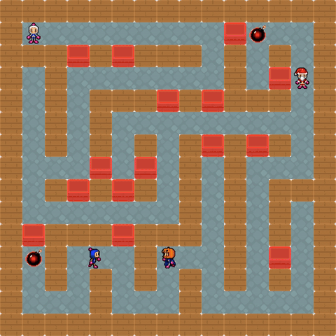

# Bomberman

Un Bomberman multijoueur en temps réel, en Java 25 et JavaFX 21 : en solo contre des bots, ou en ligne jusqu'à quatre. Projet d'équipe de 2e année de BUT Informatique (SAÉ S4, IUT de Caen) ; ce dépôt est ma copie personnelle.



## Fonctionnalités

### Gameplay
- Déplacements dans les quatre directions, bloqués par les murs et les bombes.
- Stock de bombes limité, rechargé toutes les 5 secondes.
- Explosions en croix (rayon de 2 cases, au bout de 3 secondes), arrêtées par les murs, qui détruisent les briques.
- Le dernier survivant gagne.
- 35 personnages au choix, sprites animés pour les déplacements, les bombes et les explosions.

### Bots
Trois stratégies, toutes appuyées sur une recherche de chemin par parcours en largeur :

| Stratégie | Comportement |
|---|---|
| Agressive | Chasse le joueur le plus proche, pose une bombe quand il est aligné, fuit les explosions. |
| Survivante | Fuit les adversaires en début de partie, devient agressive en un contre un. |
| Tactique | Détruit d'abord les briques et vérifie toujours qu'elle a une issue avant de poser. |

### Labyrinthes générés
- **Exhaustif** : backtracking récursif, puis 60 % de briques réparties au hasard.
- **Fusion aléatoire** : chemins fusionnés avec une structure Union-Find.

### En ligne
- Salons de quatre personnages au plus, bots compris ; seul l'hôte lance la partie.
- Taille de carte, durée et nombre de bombes réglables, chat dans la salle d'attente.
- Un joueur qui se déconnecte en pleine partie est éliminé, la partie continue pour les autres.

## Lancer le projet

Il faut Java 25. Maven n'a pas besoin d'être installé : le projet embarque son wrapper (`mvnw`, ou `mvnw.cmd` sous Windows), et JavaFX arrive avec les dépendances.

```bash
./mvnw install -DskipTests                                                  # tout compiler
./mvnw -f ServerSide/pom.xml exec:java -Dexec.mainClass=org.example.Main    # serveur, port 3000
./mvnw -f ClientSide/pom.xml javafx:run                                     # client
```

- **Solo** : dans le client, Play puis Play Offline, régler la partie, jouer. Aucun serveur n'est nécessaire.
- **En ligne** : démarrer le serveur, puis dans chaque client Play, renseigner l'IP, le port 3000 et un pseudo, puis Play Online pour créer ou rejoindre un salon.

Commandes : flèches pour se déplacer, Espace pour poser une bombe, F11 pour le plein écran.

## Comment c'est fait

```
Common/      Modèle partagé : entités, bots, labyrinthes, messages réseau, logs
ServerSide/  Serveur TCP : salons, boucle de jeu, diffusion de l'état
ClientSide/  Interface JavaFX : vues FXML, réseau client, rendu des sprites
```

- **Serveur faisant autorité** : la partie est simulée sur le serveur à 60 ticks par seconde, bots compris. Les clients envoient leurs actions et affichent l'état qu'ils reçoivent 20 fois par seconde. Un client ne commande que son propre personnage, et pas plus vite qu'une case toutes les 120 ms.
- **Protocole** : messages binaires `[1 octet de type][4 octets de longueur][JSON en UTF-8]`, 20 types de messages.
- **Design patterns** : Singleton (`ServerManager`, `NetworkManager`, `SceneManager`), Factory (`MazeFactory`, `AIFactory`, `MessageFactory`), Strategy (stratégies des bots), Observer (diffusion de l'état aux clients), Chaîne de responsabilité (logs console puis fichier).
- **Tests** : `./mvnw verify` compile les trois modules et lance les tests ; GitHub Actions fait de même à chaque push.

Le sujet de la SAÉ est dans [docs/sujet.md](docs/sujet.md).

## Équipe et ma contribution

Groupe B de la SAÉ S4, IUT Informatique de Caen. Le jeu a été écrit en équipe en quatre jours, du 29 mars au 2 avril 2026.

**Pendant le projet**, je me suis occupé des entités du jeu (joueur, bombes, collisions, explosions) et de tout le module des bots : les trois stratégies et leur recherche de chemin.

**Après le rendu**, j'ai repris le projet pour l'auditer et le corriger :

- **Juin 2026** : correction de bugs de réseau et de concurrence, factorisation du parcours en largeur des bots, suppression de messages dupliqués, remise en état des tests.
- **Octobre 2026** : la partie est désormais simulée par le serveur. Avant, il se contentait de relayer les touches et chaque client simulait sa propre partie, si bien que les écrans divergeaient.
- Corrections de jeu : bots qui contournent les bombes et fuient les leurs, vitesse de déplacement constante, sprites mal associés, écran de fin, clavier inopérant en ligne.
- Salons : hôte seul à lancer la partie, quatre personnages au plus, taille de carte, durée, nombre de bombes et chat.
- Tests ajoutés sur les bots, le décompte des éliminations et la sérialisation de l'état de jeu.
